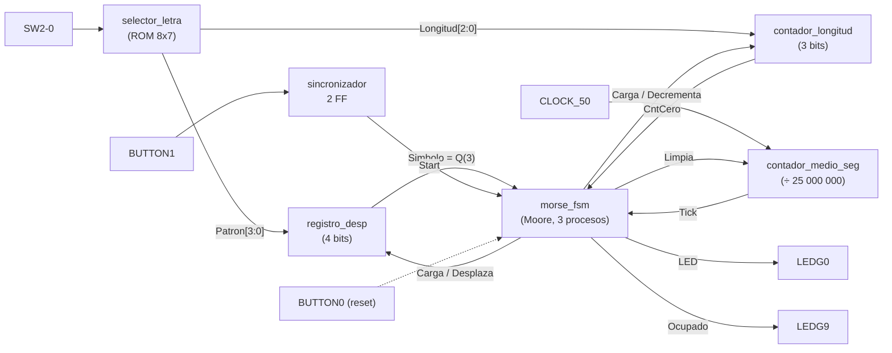
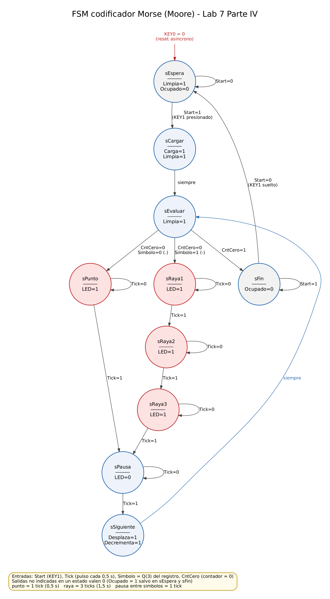
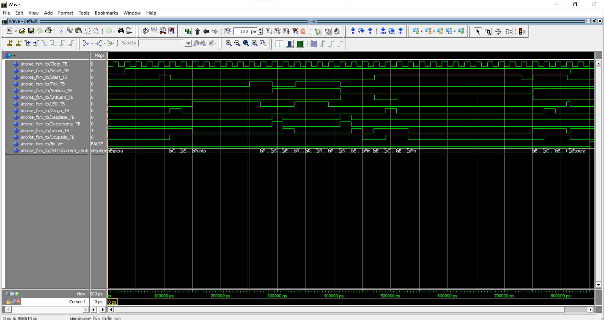
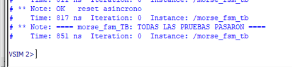
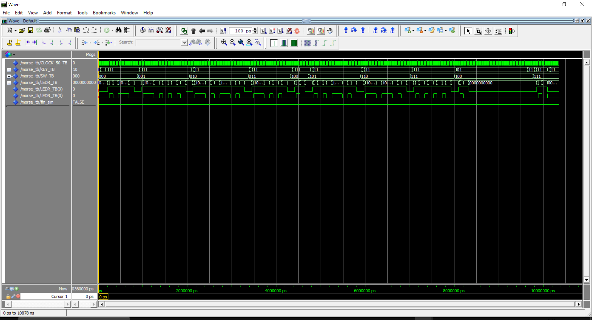
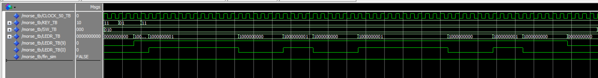
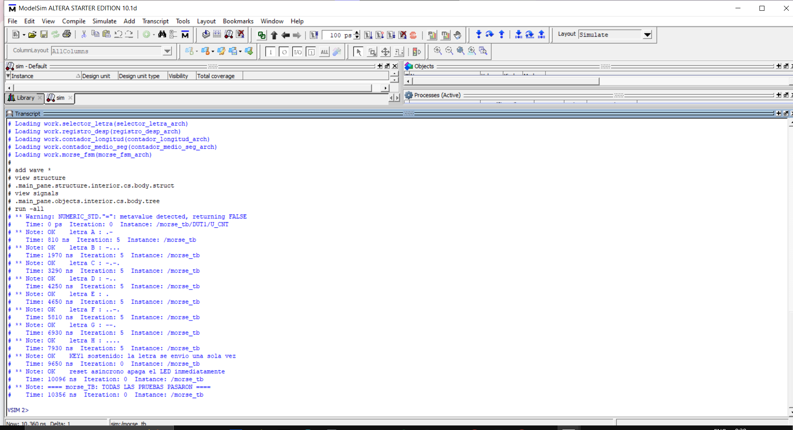

# Laboratorio 7 · Parte IV: Codificador de código Morse (FSM en VHDL)

**Curso:** DISEÑO DE CIRCUITOS DIGITALES CON VHDL
**Estudiante:** _<SARA VALENTINA DIAZ GUTIERREZ>_  ·  **Código:** _<100625011355>_
**Trabajo individual**

Este circuito muestra en un LED de la tarjeta **DE0** el código Morse de una letra entre **A** y **H**. La letra se elige con `SW2-0` y se envía al presionar `BUTTON1`. `BUTTON0` es el reset asíncrono.

- **Punto** = LED encendido **0,5 s**
- **Raya** = LED encendido **1,5 s**
- Entre símbolos, el LED queda apagado 0,5 s

| SW2-0 | Letra | Morse | Patrón (MSB primero, 1 = raya) | Longitud |
|:---:|:---:|:---:|:---:|:---:|
| 000 | A | `.-`   | `0100` | 2 |
| 001 | B | `-...` | `1000` | 4 |
| 010 | C | `-.-.` | `1010` | 4 |
| 011 | D | `-..`  | `1000` | 3 |
| 100 | E | `.`    | `0000` | 1 |
| 101 | F | `..-.` | `0010` | 4 |
| 110 | G | `--.`  | `1100` | 3 |
| 111 | H | `....` | `0000` | 4 |

---

## Entregables

| # | Entregable | Dónde está |
|---|---|---|
| 1 | Diagrama de la máquina de estados | [`diagrama/fsm_morse.png`](diagrama/fsm_morse.png) |
| 2 | Código VHDL de la FSM (tres procesos) | [`morse_fsm/morse_fsm.vhd`](morse_fsm/morse_fsm.vhd) |
| 3 | Testbench de la FSM | [`morse_fsm/morse_fsm_TB.vhd`](morse_fsm/morse_fsm_TB.vhd) y [`morse/morse_TB.vhd`](morse/morse_TB.vhd) · capturas en [`modelsim/`](modelsim) |
| 4 | Implementación y prueba | Proyecto final [`morse/`](morse) (DE0)|

## Organización del proyecto

Cada bloque es un proyecto de Quartus independiente, y el proyecto final **`morse`** los une.

```
lab7/
├── README.md
├── diagrama/             fsm_morse.png              → diagrama de estados
├── selector_letra/       selector_letra.vhd         → ROM: patrón y longitud de cada letra
├── registro_desp/        registro_desp.vhd          → registro de desplazamiento (4 bits)
├── contador_longitud/    contador_longitud.vhd      → cuenta los símbolos que faltan
├── contador_medio_seg/   contador_medio_seg.vhd     → genera un pulso cada 0,5 s
├── morse_fsm/            morse_fsm.vhd              → FSM de control (3 procesos)
│                         morse_fsm_TB.vhd           → testbench de la FSM
│                         sim_morse_fsm_TB.do        → script de ModelSim
├── morse/                morse.vhd                  → entidad tope: une todos los bloques
│                         morse_TB.vhd               → testbench del sistema completo
│                         sim_morse_TB.do            → script de ModelSim
│                         morse.qsf                  → dispositivo y pines de la DE0
│                         output_files/morse.sof     → archivo para programar la FPGA
└── modelsim/             capturas de la simulación
```

## 1. Arquitectura (Figura 5 del enunciado)



## 2. Diagrama de la máquina de estados



Es una máquina de **Moore**: las salidas dependen solo del estado.

| Estado | Salidas activas | Qué hace |
|---|---|---|
| `sEspera` | Limpia | Reposo. Espera `KEY1` |
| `sCargar` | Carga, Limpia | Carga el patrón en el registro y la longitud en el contador |
| `sEvaluar` | Limpia | Si el contador vale 0 va a `sFin`; si no, `Simbolo` decide entre punto y raya |
| `sPunto` | LED | LED encendido 1 tick (0,5 s) |
| `sRaya1..3` | LED | LED encendido 3 ticks (1,5 s) |
| `sPausa` | — | LED apagado 1 tick entre símbolos |
| `sSiguiente` | Desplaza, Decrementa | Pasa al siguiente símbolo |
| `sFin` | — | Espera que se suelte `KEY1` para no repetir la letra |

`Ocupado` (LEDR9) vale 1 en todos los estados excepto `sEspera` y `sFin`. 

## 3. FSM en VHDL con tres procesos

`morse_fsm/morse_fsm.vhd` sigue la estructura vista en clase:

```vhdl
type State_Type is (sEspera, sCargar, sEvaluar, sPunto, sRaya1, sRaya2,
                    sRaya3, sPausa, sSiguiente, sFin);
signal current_state, next_state : State_Type;

-- 1) MEMORIA DE ESTADO (reset asíncrono activo en bajo)
STATE_MEMORY : process (Clock, Reset)
begin
    if (Reset = '0') then
        current_state <= sEspera;
    elsif (Clock'event and Clock = '1') then
        current_state <= next_state;
    end if;
end process;

-- 2) LÓGICA DE TRANSICIÓN DE ESTADOS
NEXT_STATE_LOGIC : process (current_state, Start, Tick, Simbolo, CntCero)
begin
    case (current_state) is
        when sEspera => if (Start = '1') then next_state <= sCargar;
                        else next_state <= sEspera; end if;
        ...
    end case;
end process;

-- 3) LÓGICA DE SALIDA (Moore)
OUTPUT_LOGIC : process (current_state)
begin
    LED <= '0'; Carga <= '0'; ...           -- valores por defecto
    case (current_state) is
        when sPunto => LED <= '1';
        ...
    end case;
end process;
```

## 4. Testbenches y simulación 

Para que la simulación sea rápida, en el testbench el genérico `N_MEDIO_SEG` vale **4**, así que "medio segundo" son 4 ciclos de reloj (80 ns). En la tarjeta vale 25 000 000 (0,5 s).

### 4.1 `morse_fsm_TB.vhd`: la FSM sola

Maneja directamente las entradas de la FSM (`Start`, `Tick`, `Simbolo`, `CntCero`) y con `assert` verifica las salidas en cada estado. Recorre la letra **A** (`.-`) y prueba `KEY1` sostenido y el reset asíncrono. **Resultado: 22/22 verificaciones correctas.**



En la fila `current_state` se ve la secuencia **sEspera → sCargar → sEvaluar → sPunto → sPausa → sSiguiente → sEvaluar → sRaya1 → sRaya2 → sRaya3 → sPausa → sSiguiente → sEvaluar → sFin**. `LED_TB` está en 1 solo en sPunto y en sRaya1..3, y `Desplaza_TB`/`Decrementa_TB` dan un pulso en cada sSiguiente.



### 4.2 `morse_TB.vhd`: el sistema completo

Para cada letra A–H el testbench presiona `KEY1`, **mide la duración de cada pulso de LEDR0** (80 ns = punto, 240 ns = raya), arma el código recibido y lo compara con el esperado. También prueba `KEY1` sostenido y el reset durante una transmisión.



`SW_TB` recorre las letras `000` (A) … `111` (H). `LEDR_TB(9)` vale 1 mientras se transmite y `LEDR_TB(0)` es la salida Morse.

**Detalle de la letra C** (`SW = 010`, Morse `- . - .`): en `LEDR_TB(0)` se ven un pulso largo (raya, 12 ciclos), uno corto (punto, 4 ciclos), otro largo y otro corto.



**Resultado: las 8 letras y las 2 pruebas extra pasan.**



### Cómo correr la simulación

En ModelSim, con *File → Change Directory*, entra a la carpeta del proyecto y escribe en el *Transcript*:
- FSM sola, desde `morse_fsm/`: `do sim_morse_fsm_TB.do`
- Sistema completo, desde `morse/`: `do sim_morse_TB.do`
